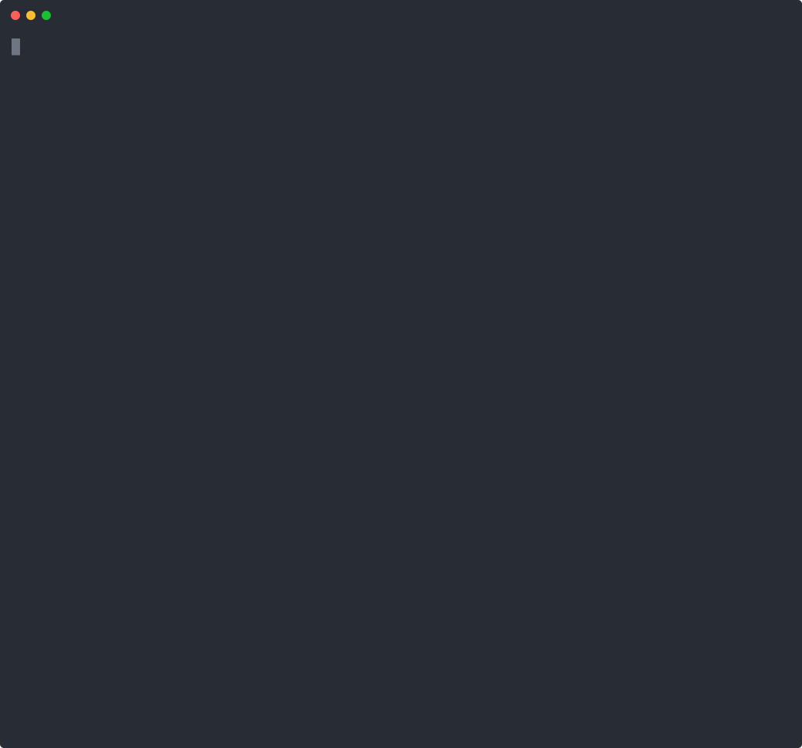
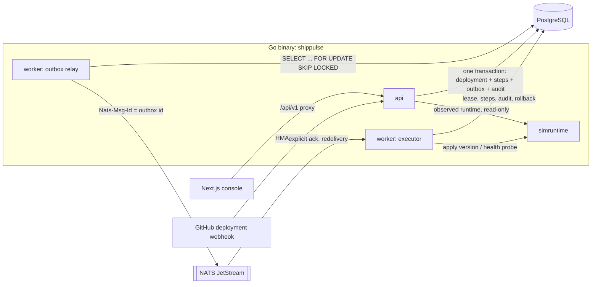

# ShipPulse — Release Safety Console

[](https://github.com/tatitoxt/shippulse/actions/workflows/ci.yml)

ShipPulse is a portfolio project that models the control plane of a safe deploy pipeline:
a deploy request (manual or GitHub `deployment` webhook) is validated, persisted with a
transactional outbox, delivered through NATS JetStream to an idempotent worker, applied to a
**simulated** runtime, health-probed, and automatically rolled back to the last stable version
when probes fail. Every step is recorded in an append-only audit log and shown in a web console
that reads the real API.

> Scope: the default runtime is a deterministic simulator (`internal/simruntime`), and the demo,
> integration and E2E tests all run against it. Kubernetes (`kubectl`) and Nomad backends exist
> behind the same `Provider` interface but are opt-in and only tested against fakes (a stubbed
> `kubectl` runner and an `httptest` Nomad API), never against a real cluster. ShipPulse has no
> production users.

## The problem

Release tooling has to stay correct when things go wrong: a request is retried, a message is
delivered twice, a worker dies mid-deploy, the new version fails health checks. The interesting
part is not the happy path but proving that the system never runs two deploys on the same
target, never loses a requested deploy, and always restores the last known-good version — and
that an operator can see the evidence afterwards.

## What it does today

- **Deploy requests**: `POST /api/v1/deployments` (JWT, `Idempotency-Key` header) or a signed
  GitHub `deployment` webhook (HMAC-SHA256, delivery id used for deduplication; `push` events are ignored).
- **Validation**: service and environment must belong to the caller's organization and project;
  versions are validated; viewers get `403`.
- **Transactional outbox**: deployment, its four ordered steps, the outbox event and the audit
  event are written in one PostgreSQL transaction. A relay publishes to NATS JetStream with
  `Nats-Msg-Id` deduplication and exponential backoff on failure.
- **Idempotent worker**: claims deployments with a lease (`lease_owner`, `lease_expires_at`),
  skips completed steps when resuming after a crash, fences off workers that lost their lease,
  and ignores duplicate deliveries. A partial unique index allows only one running deployment
  per service/environment.
- **Lifecycle**: `validate → apply_version → health_probe → [canary_<pct>…] → promote`.
  A request may carry `"canary": [10, 50]` — strictly increasing weights, 1-99 — and the
  worker inserts one `canary_<pct>` step per weight before `promote`, calling the provider's
  `SetTraffic` and re-probing health between shifts; a failed canary step rolls back like
  any other. With `CANARY_METRICS_URL` + `CANARY_METRICS_QUERY` + `CANARY_METRICS_THRESHOLD`
  set, each weight is also gated on a real error signal: the worker evaluates a Prometheus
  instant query (any compatible API — Prometheus, VictoriaMetrics, Mimir) and rolls back
  when the scalar result exceeds the threshold or the query fails (fail-closed).
  `CANARY_METRICS_CHECKS` widens the gate to several named checks — a JSON array of
  `{"name", "query", "threshold"}` so a scalar error-rate check can run alongside
  `histogram_quantile` latency checks (e.g.
  `[{"name":"p99","query":"histogram_quantile(0.99, rate(http_request_duration_seconds_bucket[5m]))","threshold":0.5}]`); every check must pass, and rollback names the breached check. The simulated runtime
  supports the failure profiles `healthy`, `unhealthy`, `timeout` and `provider_unavailable`.
- **Real provider backends (opt-in, untested against real clusters)**: `PROVIDER=kubectl` swaps the simulated runtime for a real
  Kubernetes backend driven by the `kubectl` CLI. It maps each target to a Deployment
  named `<service>-<environment>` in `KUBECTL_NAMESPACE` (default `default`), applies via
  `kubectl set image`, probes by ready replicas, and — with `CANARY_INGRESS=true` —
  drives canary weights through the NGINX Ingress `canary-weight` annotation on an
  Ingress named like the Deployment. `PROVIDER=nomad` targets the Nomad HTTP API
  (`NOMAD_ADDR`, optional `NOMAD_TOKEN`/`NOMAD_IMAGE_PREFIX`): `Apply` registers a
  `<service>-<environment>` docker job, `Probe` requires job status `running`,
  and `SetTraffic` promotes the latest deployment at 100% (intermediate canary
  steps only add bake time — Nomad canaries gate on task counts, not traffic
  weight).
- **Automatic rollback**: a failed health probe marks the deployment `failed` and queues a
  separate rollback operation that re-applies and re-probes the previous stable version.
  Rollbacks that fail are reported as failed (never as "rolled back") and can be retried manually.
- **Approval gates**: a deployment created with `"requires_approval": true` stays in
  `awaiting_approval` — no worker job is enqueued — until an engineer calls
  `POST /api/v1/deployments/{id}/approve`, which records the approver, moves it to
  `queued` and enqueues work in one transaction. Approval is one-shot (a second call
  conflicts) and an awaiting deployment can still be cancelled.
- **Retries**: a terminal deployment (`succeeded`, `failed`, `cancelled`) can be cloned into a
  fresh run of the same version with `POST /api/v1/deployments/{id}/retry` — same service,
  environment, canary weights and approval gate (a gated retry waits for approval again).
  Retries are idempotent (`retry:<id>` key): repeating the call returns the existing clone.
- **Audit log**: append-only table (updates/deletes are rejected by a trigger); sensitive
  metadata keys are redacted.
- **Live updates over SSE**: `GET /api/v1/events` streams org-scoped change events emitted by
  Postgres `LISTEN/NOTIFY` triggers on `deployments`, `deployment_steps` and
  `service_environments`. A single dedicated `LISTEN` connection fans out to all subscribers
  in-process, so any number of open consoles costs exactly one database connection. The console
  refreshes instantly on each event and keeps a 30 s poll as a backstop.
  Events are persisted to `change_events` (retained for one hour) and every
  `data:` frame carries an `id:` — a reconnecting client that sends
  `Last-Event-ID` replays everything it missed before live delivery resumes.
- **GitHub commit statuses**: when `GITHUB_TOKEN` is set, the worker posts `pending` →
  `success`/`failure` statuses (context `shippulse/<environment>`) back to the deployment's
  `git_sha`, and the API posts `error` when a queued deploy is cancelled. Reporting is
  best-effort — a GitHub failure is logged, never fails the deploy. `GITHUB_API_URL`
  overrides the API base (e.g. GHES) and `STATUS_TARGET_BASE` links statuses to a dashboard.
- **Prometheus metrics**: `GET /metrics` exposes deployments/steps/rollbacks by status,
  deployment duration p50/p95 (computed at scrape time, so it covers every api and
  worker process), outbox backlog, and per-process HTTP request counters.
- **Web console** (Next.js): services with promoted vs. actually-running version, deploy form,
  deployment list, per-deployment steps, rollback and runtime evidence, audit trail.
- **Multi-tenant**: two synthetic organizations (`Acme Demo`, `Globex Demo`); every query is
  scoped by organization, and cross-tenant access returns `404`.

## Quickstart

Requirements: Docker with Compose v2, `make`. (Go 1.26 and Node 22 only for running tests locally.)

```bash
git clone https://github.com/tatitoxt/shippulse.git
cd shippulse
make demo          # builds and starts the stack, then runs the scripted demo
```

<p align="center">
  
</p>

`make demo` deploys `checkout-api` to `staging` three times through the real HTTP API:

1. `v1.0.0` manual deploy, healthy → **succeeded**
2. `v1.1.0` via a signed GitHub `deployment` webhook, healthy → **succeeded**
3. `v1.2.0` manual deploy with `failure_profile=unhealthy` → **failed**, then the automatic
   rollback restores **v1.1.0**; the demo checks that both the promoted version and the
   simulated runtime report `v1.1.0` and prints the audit trail.

Then open http://localhost:3000 and sign in as `operator@acme.example` (engineer),
`viewer@acme.example` (read-only) or `operator@globex.example` (second tenant). The password is
`DEMO_PASSWORD`, which defaults to `shippulse-demo` in `docker-compose.yml`.

All credentials in `docker-compose.yml` are throwaway demo defaults; override `POSTGRES_PASSWORD`,
`JWT_SECRET`, `GITHUB_WEBHOOK_SECRET` and `DEMO_PASSWORD` via environment variables for anything else.
Ports are published on `127.0.0.1` only.

```bash
make down          # stop the stack
make demo-reset    # stop and delete all demo data
```

Manual API example (after `make up`):

```bash
TOKEN=$(curl -s localhost:8080/api/v1/auth/login \
  -d '{"email":"operator@acme.example","password":"shippulse-demo"}' | jq -r .token)
curl -s -H "Authorization: Bearer $TOKEN" localhost:8080/api/v1/services | jq '.services[].slug'
```

## Architecture



One Go module, one binary with subcommands (`migrate`, `seed`, `api`, `worker`, `simruntime`,
`demo`). Details: [ARCHITECTURE.md](ARCHITECTURE.md), the
[lifecycle spec](docs/spec/release-lifecycle.md) and the ADRs in [docs/adr](docs/adr).

| Path | Responsibility |
|---|---|
| `internal/domain` | state machines, validation, roles, backoff |
| `internal/store` | PostgreSQL persistence: transactional create, leases, outbox, audit |
| `internal/migrate` | embedded, versioned SQL migrations |
| `internal/outbox`, `internal/bus` | outbox relay and NATS JetStream publish/consume |
| `internal/worker` | step executor and rollback |
| `internal/provider`, `internal/simruntime` | provider interface, HTTP client and the simulated runtime |
| `internal/api` | HTTP API, JWT auth, RBAC, GitHub webhook |
| `apps/web` | Next.js console and Playwright E2E |

## Tests

| Suite | Command | What it covers |
|---|---|---|
| Unit | `make test` | state transitions, validation, backoff, JWT, webhook signatures, simulated runtime and provider |
| Integration | `make deps-up && make test-integration` | real PostgreSQL + NATS: atomic create (with injected failure), idempotency (incl. concurrent requests), leases and crash resume, duplicate delivery, outbox retry, timeout, provider unavailable, automatic and manual rollback, failed rollback, tenant isolation, viewer denial, webhook handling |
| E2E | `make e2e` | Playwright drives the browser against the full Compose stack: healthy deploy, failed deploy auto-rolled-back, evidence after reload, viewer denial (UI and API), tenant isolation |
| Lint / types | `make lint`, `make web-check` | gofmt, go vet, ESLint, `tsc --noEmit`, production build |
| Audits | `make vuln` | govulncheck and `npm audit --audit-level=high` |

Measured in this repository (count them with `go test -list . ./...` and
`go test -tags=integration -list . ./...`): 101 Go test functions — 51 unit and 50 integration —
plus 3 Playwright E2E tests. The SSE endpoint is covered by live integration tests that drive a
deployment through real `pg_notify` triggers and assert org isolation on the stream. All of them run in [GitHub Actions](.github/workflows/ci.yml) on every
pull request and push to `main`, together with `make demo`.

## Benchmarks

Measured in a Devin VM (8 vCPU Intel Xeon, 31 GiB RAM) against the Compose PostgreSQL 16.10 and
NATS 2.11.9 containers, with the in-memory provider and the healthy profile, so this is the
control-plane overhead only. Details and reproduction commands: [docs/benchmarks.md](docs/benchmarks.md).

| Benchmark | Result |
|---|---|
| `BenchmarkDeploymentEndToEnd` (create → promoted, sequential, 3 runs × 30) | 29.8–33.1 ms per deployment |
| `TestLoadMultiWorker` (8 workers, 120 deployments) | 5.5 s, about 21.8 deployments/s, every step ran exactly once |

These are local measurements on one machine, not production numbers.

## Limitations

- The default runtime is simulated in memory: its state resets when the `simruntime` container
  restarts, and "health" is decided by the failure profile chosen at deploy time.
- The `kubectl` and Nomad providers, the Prometheus canary gate and OTLP trace export are tested
  only against fakes or in-process collectors; none has been run against real infrastructure.
- The demo runs a single worker process. Multiple workers are covered by the load test above,
  on one machine only.
- GitHub integration receives signed `deployment` events and reports commit statuses and
  `deployment_statuses` back (`GITHUB_TOKEN`); it does not create GitHub Deployments itself.
- Authentication is email/password with HS256 JWTs for seeded demo users, with a sliding-window
  limit on failed sign-ins (5 per 5 min per IP+email → 429). The limiter is in-memory per API
  process. There is no sign-up, password reset, SSO or token revocation.
- SSE replay covers only the last hour (`change_events` retention); older gaps are caught by the
  30 s poll backstop.
- `GET /metrics` is unauthenticated, like `/healthz`; bind the API to a private interface in any
  real deployment.
- Not security-audited and not deployed anywhere; the Compose file is for local demos.

## Roadmap

- Run the `kubectl` provider in CI against a throwaway kind cluster.
- Create GitHub Deployments from ShipPulse (not only report on existing ones).
- Shared (database-backed) login rate limiting across API replicas.
- Authenticated `/metrics` and token revocation.

## License

[MIT](LICENSE) © Fausto Pastura

