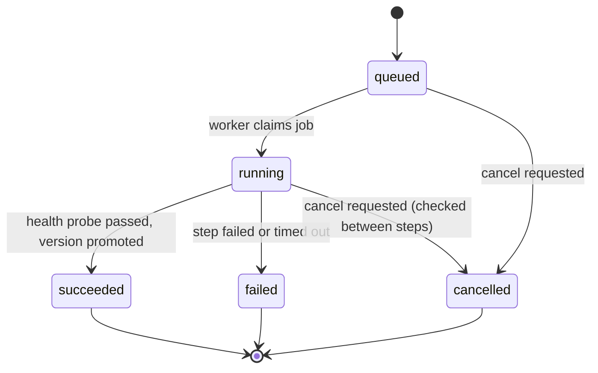
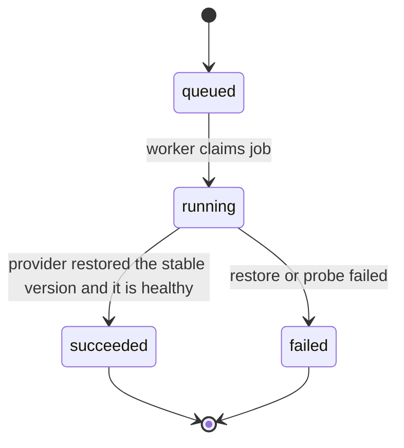

# Release lifecycle specification

Status: accepted for the first vertical slice. This document is the contract the
code and tests are written against. Anything not described here is out of scope.

## Problem

A small team needs to know which version was attempted, which steps ran, why a
release failed and whether returning to a known-good version actually happened.
ShipPulse is a local, demo-grade *release safety console*: it records each
release attempt, runs it through a simulated runtime, probes health, and rolls
back automatically when the probe fails, keeping an audit trail of every step.

ShipPulse does **not** deploy to real infrastructure. The only provider is a
simulated runtime (`simruntime`) that keeps per-service state in memory.

## Actors

- **Operator** (`ENGINEER` role or higher): requests deployments and rollbacks.
- **Viewer** (`VIEWER` role): reads services, deployments and audit events.
- **GitHub**: sends signed `deployment` webhooks that become deployment requests.
- **Worker**: consumes jobs from NATS and drives the provider.

## State machines

Deployment:

Rollback operation (a child of a deployment, with its own state):

Rules:

- Terminal states never change. Any other transition is rejected by
  `internal/domain` and recorded as a `deployment.transition_rejected` audit event.
- A failed deployment is never marked "rolled back" by itself. The API exposes the
  rollback as a separate object; the UI shows "rolled back" only when the rollback
  operation is `succeeded`.
- At most one deployment per (service, environment) can be `running`
  (partial unique index). A second job waits and is redelivered.

## Steps

Every deployment has four ordered steps, inserted in the same transaction as the
deployment row:

| # | name | what it does |
|---|------|--------------|
| 1 | `validate` | re-checks that service and environment still belong to the tenant and records the current stable version |
| 2 | `apply_version` | calls `DeploymentProvider.Apply` (retried on provider errors) |
| 3 | `health_probe` | probes the runtime health endpoint with per-attempt timeout, retries and an overall deadline |
| 4 | `promote` | marks the version as current/stable for the service environment |

Step states: `pending → running → succeeded | failed | skipped`. Each transition
is persisted before the worker moves on. `safe_output` holds a short,
non-sensitive human message (never raw provider payloads).

## Acceptance scenarios

1. **Healthy deploy.** Given `checkout-api` runs stable `v1` in `staging`, when an
   operator requests `v2` with the `healthy` profile, then a deployment is created
   in `queued`, steps run in order to `succeeded`, the runtime reports `v2`, and
   the API and UI show the same state.
2. **Failure and automatic rollback.** Given stable `v1`, when `v2` is deployed
   with the `unhealthy` profile, then `health_probe` fails, the deployment ends
   `failed` with `error_code=health_check_failed`, a rollback operation restores
   `v1` in the runtime and ends `succeeded`, and audit events record cause and
   result.
3. **Idempotent request.** Repeating `POST /api/v1/deployments` with the same
   `idempotency_key` returns the same deployment (HTTP 200 instead of 202) and the
   provider is invoked once.
4. **Duplicate event.** Delivering the same job twice does not apply the version
   twice nor duplicate terminal steps (the claim is guarded in PostgreSQL).
5. **Persistence/publish failure.** If inserting the steps fails, the request
   returns 500 and no deployment, step or outbox row remains. If NATS is down,
   the request still succeeds and the outbox row stays pending until the relay
   can publish it.
6. **Timeout.** Each step has a timeout; a hanging health endpoint (`timeout`
   profile) fails the probe, the deployment ends `failed` with
   `error_code=health_check_timeout` and the worker is free for the next job.
7. **Tenant isolation.** A user of tenant B gets 404 for services and deployments
   of tenant A, and cannot deploy to them. A `VIEWER` gets 403 on writes.

## Failure profiles (simulated runtime)

| profile | effect |
|---------|--------|
| `healthy` (default) | version applies, health returns 200 |
| `unhealthy` | version applies, health returns 503 |
| `timeout` | version applies, health never answers within the probe timeout |
| `provider_unavailable` | apply returns 503; the deployment fails without changing the runtime, so no rollback is needed |

## API contract

All endpoints require `Authorization: Bearer <jwt>` except login and the webhook.
Errors are `{"code","message","correlation_id"}`; no stack traces.

- `POST /api/v1/auth/login` `{email,password}` → `200 {token, role, organization}`
- `GET /api/v1/services` → services with per-environment current version
- `GET /api/v1/services/{id}/releases?environment_id=&limit=&before=` → paginated history
- `GET /api/v1/services/{id}/runtime?environment_id=` → version observed in the simulated runtime
- `POST /api/v1/deployments` `{service_id, environment_id, version, idempotency_key, failure_profile?}` → `202 {id,status}` (or `200` for an idempotent replay)
- `GET /api/v1/deployments?limit=` → latest deployments
- `GET /api/v1/deployments/{id}` → deployment, ordered steps, rollback, audit trail
- `POST /api/v1/deployments/{id}/rollback` `{reason, idempotency_key}` → `202 {rollback_id,status}`
- `GET /api/v1/audit-events?subject_id=` → audit events
- `POST /api/v1/webhooks/github` → handles `deployment` and `ping` events only

## Out of scope

Real infrastructure (`kubectl`, SSH, cloud APIs), canary/traffic shifting,
multi-region, production secrets, billing and any availability claims.
